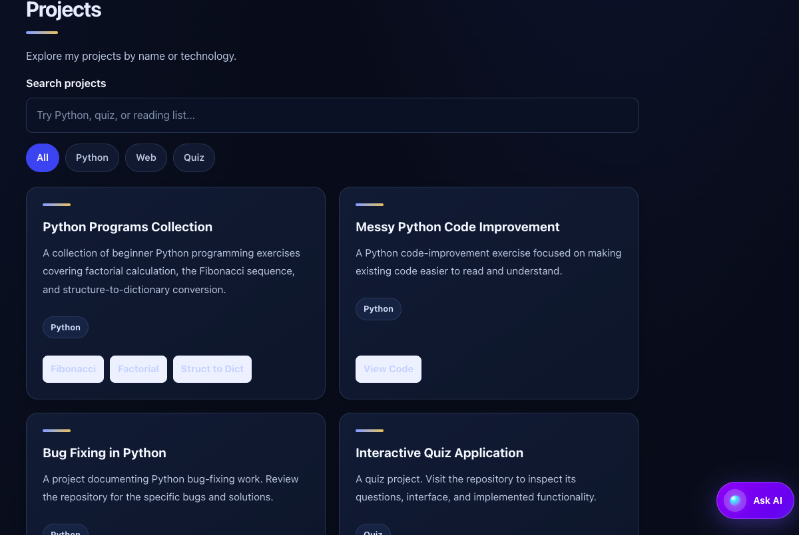

# Personal Portfolio

A responsive personal portfolio showcasing my profile, skills, projects, and professional links.

## 🌐 Live Portfolio

**[Visit My Portfolio](https://portfolio-i96cr7zv8-tanuj-portfolio.vercel.app/)**


## 📸 Screenshots

### Hero and About Section


### Skills and Projects Section




## 🛠️ Tech Stack

- HTML5
- CSS3
- JavaScript
- Node.js serverless API endpoints
- Git and GitHub
- Vercel

## ✨ Features

- Responsive portfolio design
- Personal profile and About section
- Skills and projects showcase
- GitHub and professional profile links
- Weather widget with live weather information
- AI-powered chatbot
- Dark/light theme toggle
- Server-side API endpoints for weather and chatbot functionality

## 🚀 Run Locally

### Prerequisites

- Git
- Node.js and npm
- Vercel CLI (for running the Vercel API endpoints locally)

### Steps

1. Clone the repository:

   ```bash
   git clone https://github.com/Tanuj-X/portfolio.git
   ```

2. Open the project folder:

   ```bash
   cd portfolio
   ```

3. Install the Vercel CLI if it is not already installed:

   ```bash
   npm install -g vercel
   ```

4. Configure the required environment variables for the weather and chatbot APIs.

5. Start the local development server:

   ```bash
   vercel dev
   ```

6. Open the local URL shown in your terminal.

**Note:** Opening `index.html` directly may not enable API-dependent features because the API endpoints require a server environment.

## ☁️ Deployment

This portfolio is hosted on Vercel and connected to GitHub.

To deploy updates:

1. Commit and push your changes to GitHub.
2. Allow Vercel to build and deploy the latest changes.
3. Check the live website to confirm everything works.

Ensure the required environment variables are configured in Vercel Project Settings.

## 📌 Current Limitations

- Project details must be updated manually.
- Weather and chatbot functionality require valid API configuration and network access.
- The portfolio does not currently include a contact form submission service.

## 👨‍💻 Author

**Tanuj Dangi**

GitHub: [Tanuj-X](https://github.com/Tanuj-X)
